<div align="center">

# Fin Track

**A Modern Multi-Entity Personal & Business Finance Manager — Web Dashboard, Flutter Mobile App & AI Assistant**

[](#)
[](#)
[](#)
[](#)
[](#)
[](#)
[](https://github.com/saburali/fintrack-showcase/commits/main)
[](#)

*Combining multi-entity financial tracking, interactive charts, an embedded AI Assistant powered by Google Gemini, real-time support messaging, a calendar-based transaction planner, a complete loan tracker, and a Flutter mobile companion — all behind a modern, glassmorphic, fully responsive UI.*

---

[🎯 Overview](#-overview) •
[📋 Feature Index](#-complete-feature-index-at-a-glance) •
[✨ Key Features](#-key-features) •
[📸 Screenshots](#-screenshots--visual-tour) •
[🏗️ Architecture](#️-system-architecture) •
[🛡️ Security](#️-security-engineering) •
[🧰 Tech Stack](#-tech-stack)

</div>

---

> [!IMPORTANT]
> **🚧 Project Status — Development in Progress:**
> **Development is currently ongoing. Once completed, the final Web build & Mobile APK (`.apk`) / AAB will be shared here.**
>
> *To protect proprietary business logic, schema designs, and AI prompt chains, the source code is maintained in a private repository. This repository serves as an architectural showcase, visual feature tour, and release distribution hub for **Fin Track**.*

---

## 🎯 Overview

**Fin Track** is a full-stack, multi-entity finance management platform built as a triple-surface product: a **React 18 + Tailwind web dashboard**, a **Flutter mobile companion app** (Android / iOS), and a **PHP/MySQL REST backend** that powers both. It unifies **transaction tracking**, **multi-entity support** (Personal / Organization / Institute), **interactive analytics dashboards**, **AI-powered financial insights** (Google Gemini), **calendar-based money planning**, **loan tracking with repayment progress**, **member & contact management**, **payment method ledgering**, and **real-time support messaging** — all behind a fully responsive, bilingual (English & Bengali) interface.

---

## 📋 Complete Feature Index (At a Glance)

Below is the complete list of features engineered into **Fin Track**:

- **🌐 Web Dashboard (React 18 + Tailwind)**
  - **Multi-Entity Workspace** — Switch instantly between `Personal`, `Organization`, and `Institute` financial ledgers with isolated transactions, categories, and members
  - **Interactive Dashboard Home** — Stat cards (Income, Expense, Balance, Net Worth), monthly trend line chart, category donut chart, payment method chart, and recent transaction feed
  - **Transaction Manager** — Full CRUD with multi-filter (`type`, `category`, `payment method`, `member`, `date range`), instant search, and batch operations
  - **Calendar-Based Transaction View** — Month-grid calendar with per-day totals, daily drill-down, and visual heat indicators
  - **Smart Filter Panel** — Date range pickers (`flatpickr`), category & payment method dropdowns (`react-select`), saved filter presets
  - **Category & Payment Method Library** — Create/edit categorized ledger buckets and payment methods with custom icons, colors, and usage counters
  - **Loan Tracker** — Track borrowed (`You Owe`) and lent (`Owed to You`) amounts with repayment progress bars, settlement status, and per-loan history
  - **Member Management** — Store contacts (name, relation, photo, phone) associated with transactions and loans
  - **Profile & Entity Settings** — Edit profile, switch active entity, configure app-wide currency (`BDT` default) and date format
  - **Live Support Messaging (Socket.IO)** — Real-time chat threads with admin reply delivery and typing indicators
  - **AI Financial Assistant** — In-app conversational assistant powered by **Google Gemini**, with quick prompts (Spending Summary, Saving Tips, Top Expenses, How Features Work)
  - **Multi-Language UI** — Full Bengali (`bn`) + English (`en`) translations with native language names
  - **Theme Engine** — Dark Mode / Light Mode with persistent `localStorage` preference
  - **Landing / Marketing Site** — Public-facing `Hero`, `Features`, `How It Works`, `FAQ`, `Contact`, and `Demo` pages with `framer-motion` + `gsap` + `three.js` micro-animations
  - **Admin Panel** — Dedicated admin login, user read-only workspace, support triage dashboard, and CMS for landing page content
  - **Super Admin Console** — System-wide settings, brand logo upload, captcha key management, and Gemini API key management
  - **Animated UI Primitives** — Sidebar transitions, modal dialogs, toast notifications (`sonner`), and chart tooltips using `framer-motion`

- **📱 Flutter Mobile App (Android / iOS)**
  - **Material 3 Dark-Optimized UI** — Cyan accent (`#06B6D4`) on deep slate background (`#020617`) with light theme fallback
  - **Bottom Navigation Shell** — `Home` / `Transactions` / `Calendar` / `More` tabs with active route highlighting
  - **Authentication Flow** — Splash → Bootstrap → Login → Main shell with secure session via `shared_preferences`
  - **Mobile Dashboard** — Stats summary, recent transaction feed, and condensed `fl_chart` visualizations
  - **Transaction Editor Sheets** — Bottom-sheet forms (`category_editor_sheet`, `payment_method_editor_sheet`, `transaction_editor_sheet`, `member_editor_sheet`) for touch-first data entry
  - **Calendar Tab** — Native calendar with day-tap drill-down
  - **Loan Tracker Page** — Mobile-optimized loan list with repayment progress chips
  - **Members Section v2** — Card-style member roster with relation and contact info
  - **Categories Page** — Browse categories and view associated transactions
  - **Payment Methods Section** — Manage payment methods with per-method transaction drill-down
  - **Settings Section** — Profile editor, theme toggle, language switch, and logout
  - **Support Section** — In-app support thread with real-time updates
  - **PDF Export** — Generate transaction reports as PDF (`pdf` package)
  - **Share & File Pickers** — `share_plus` and `file_picker` integration for exporting and attaching data
  - **Real-Time Sync** — `socket_io_client` connection to the same Node.js Socket.IO server

- **⚙️ Backend & Infrastructure**
  - **PHP REST API (`api.php` + `api-router.php`)** — All endpoints (`/bootstrap`, `/login`, `/register`, `/transactions`, `/categories`, `/payment-methods`, `/members`, `/entities/switch`, `/settings/app`, `/support/thread`)
  - **MySQL Persistence** — Full schema (`fin_track.sql`) for users, entities, transactions, categories, payment methods, members, loans, support threads, and site settings
  - **Node.js Socket.IO Server (`server.js`)** — Real-time bi-directional messaging for support threads and live updates
  - **File Upload Pipeline** — `uploads/` directory with per-user isolated folders (avatars, member photos, evidence attachments)
  - **Demo Account System** — Pre-seeded `demo-account_2` with `personal`, `organization`, and `institute` rosters for first-time visitors
  - **Cloudflare Turnstile** — Bot protection on signup & login flows with key management in Super Admin
  - **Google Gemini Integration** — Server-side API key storage and per-user rate-limit guards

---

## ✨ Key Features

### 🏠 1. Multi-Entity Financial Workspace
- **3 Built-In Entity Types**: `Personal` (family/household), `Organization` (business/operations), and `Institute` (school/club). Each entity keeps its own transactions, categories, members, payment methods, and loan records — fully isolated at the API level.
- **One-Tap Entity Switch**: The header `UserSelector` lets users swap the active entity without losing session, instantly re-rendering the dashboard with the new ledger's stats.

### 📊 2. Interactive Dashboard & Analytics
- **Stats Cards**: Real-time Income, Expense, Balance, and Net Worth tiles with month-over-month delta arrows.
- **5 Chart Types**: `MonthlyChart` (bar), `CategoryChart` (donut), `PaymentMethodChart` (donut), `TrendChart` (line), and `TransactionItemChart` — all powered by `recharts` with custom theme awareness.
- **Smart Filters**: Date range, calendar-specific bound, and "this month" preset filters applied at the data layer before charting.

### 💸 3. Transaction Management
- **Full CRUD**: Add, edit, delete transactions with category, payment method, member, amount, note, and date.
- **Multi-Filter Panel**: Combine `type`, `category`, `payment method`, `member`, and date range filters in a single collapsible panel.
- **Instant Unicode Search**: Real-time filter on transaction titles — supports Bengali & English.
- **Per-Category Drill-Down**: View all transactions under a category from the categories page.

### 📅 4. Calendar-Based Transaction View
- **Month-Grid Calendar**: Visual heat indicators for days with transactions.
- **Day Drill-Down**: Tap any date to see the day's transactions in a focused view.
- **Inline Filters**: Pre-built date range filters (Today, This Week, This Month, This Year, Custom).

### 🤖 5. In-Game AI Assistant (Google Gemini)
- **Quick Prompts**: Pre-built queries (Spending Summary, Top Expenses, Saving Tips, How Features Work).
- **Suggestion Chips**: One-tap conversation starters for common questions.
- **Conversation History**: Persisted chat history scoped to the active user & entity.
- **Server-Side Key**: API key managed in Super Admin settings — never exposed to the browser.

### 💬 6. Real-Time Support Messaging (Socket.IO)
- **Live Threads**: Users open a support thread and chat with the admin team in real time.
- **Admin Triage Dashboard**: Admins see all open threads, mark them resolved, and reply instantly.
- **Typing Indicators & Delivery Receipts**: Powered by the Node.js Socket.IO server.

### 👥 7. Member Management
- **Contact Roster**: Store name, relation (Self / Father / Mother / Sister / Cousin / Friend / etc.), phone, and avatar.
- **Member Transaction View**: Tap a member to see all transactions and loans tied to them.

### 🏦 8. Loan Tracker
- **Borrowed vs Lent**: Separate ledgers for `You Owe` and `Owed to You`.
- **Repayment Progress Bars**: Visual percentage chip per loan record.
- **Loan History**: Per-loan transaction timeline with partial repayment entries.

### 💳 9. Categories & Payment Methods
- **Categorized Ledger Buckets**: Create custom categories with icons and colors.
- **Payment Method Tracking**: Cash, Bank, Card, Mobile Wallet, and user-defined methods.
- **Usage Counters**: Each list shows how many transactions reference it.

### 🌗 10. Theme, Language & Accessibility
- **Dark / Light Mode**: Persistent theme stored in `localStorage`, applied via a React context provider.
- **Bilingual UI**: Full Bengali (`bn`) and English (`en`) translations, including native language labels.
- **Responsive Breakpoints**: Mobile-first layout that scales from 360px phones to 4K desktops.

### 🛒 11. Public Landing & Marketing Site
- **Hero, Features, How It Works, FAQ, Contact Pages**: Built with `framer-motion`, `gsap`, and `three.js` for subtle micro-interactions.
- **Admin-Managed CMS**: `AdminLandingCms` lets the admin edit all marketing copy without touching code.
- **Dynamic Brand Logo**: Logo and favicon are CMS-driven and uploaded via the Super Admin panel.

### 🔐 12. Admin & Super Admin Tools
- **Admin Login**: Separate route and credentials for admin users.
- **User Read-Only Workspace**: Admins can browse any user's data without modifying it.
- **Super Admin Console**: Manage site settings, captcha keys, Gemini API keys, brand assets, and CMS content.

---

## 📸 Screenshots & Visual Tour

Every major workflow of **Fin Track** is documented below across **two surfaces** (Web Dashboard + Flutter Mobile App) and **two themes** (Dark + Light).

---

### 🌐 1. Web Dashboard — Home

The web dashboard supports **Dark** and **Light** themes, with a fully responsive layout that adapts to any screen size. It features a collapsible sidebar, stat cards, interactive charts, and a recent transaction feed.

| 🌙 Home (Dark Theme) | ☀️ Home (Light Theme) |
| :---: | :---: |
| 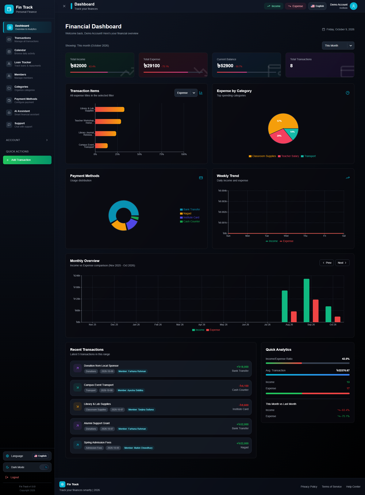 | 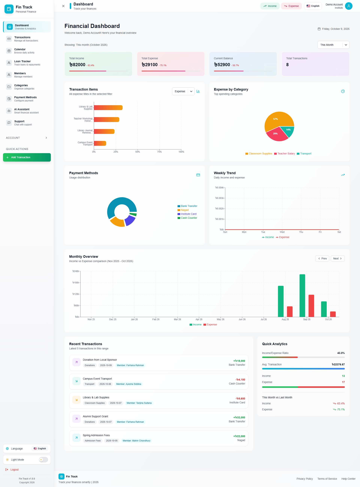 |
| *Main dashboard in Dark Mode showing income/expense/balance stats, monthly chart, category donut, payment method donut, and recent transactions.* | *Main dashboard in Light Theme with the same layout and a brighter glassmorphic background.* |

| 🌙 Sidebar Menu (Dark) | ☀️ Sidebar Menu (Light) |
| :---: | :---: |
|  |  |
| *Collapsible sidebar menu listing all primary navigation items (Dashboard, Transactions, Calendar, Categories, Payment Methods, Members, Loans, Support, AI Assistant, Admin).* | *Light theme variant of the sidebar with the same navigation items and active-state highlighting.* |

---

### 💸 2. Web Dashboard — Transactions

| 🌙 Transactions (Dark) | ☀️ Transactions (Light) |
| :---: | :---: |
| 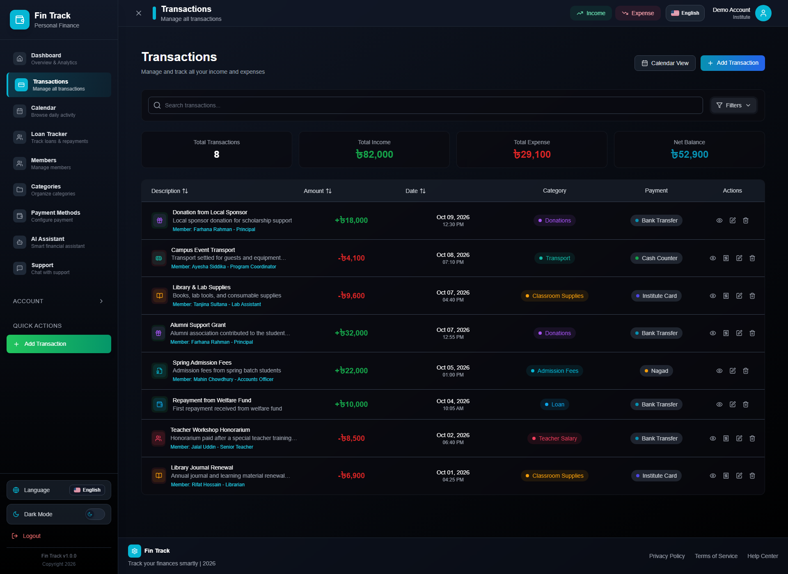 | 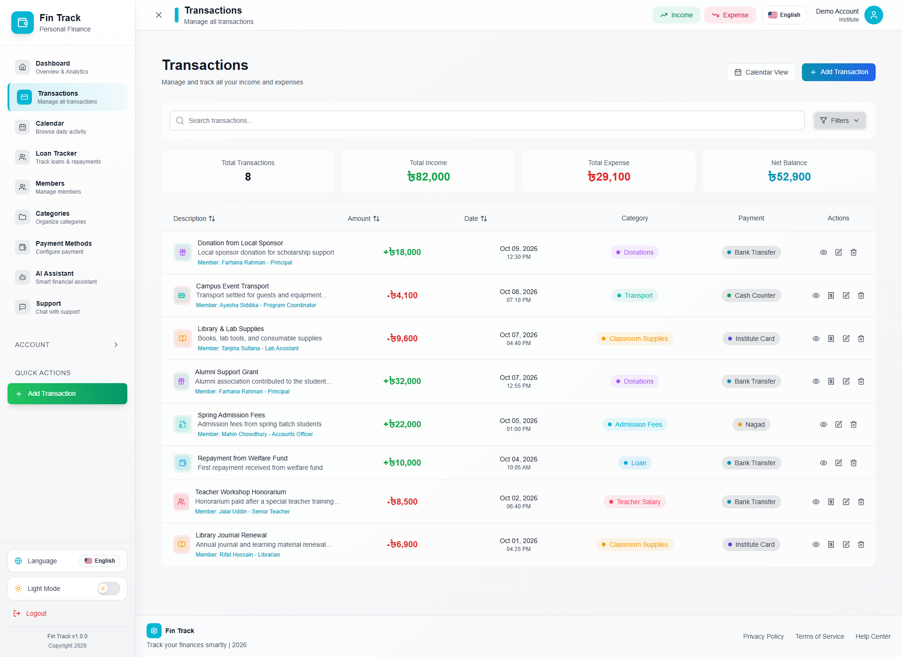 |
| *Full transaction list with multi-filter panel, instant search, sortable columns, and inline edit/delete actions.* | *Light theme transaction list with the same filter capabilities and a brighter row background.* |

| 🌙 Add / Edit Transaction (Dark) | ☀️ Add / Edit Transaction (Light) |
| :---: | :---: |
| 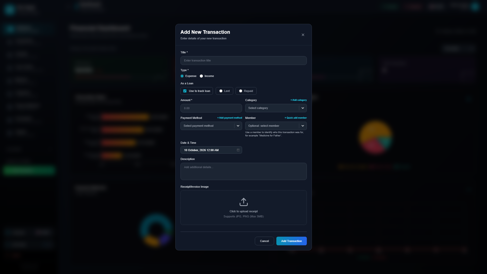 | 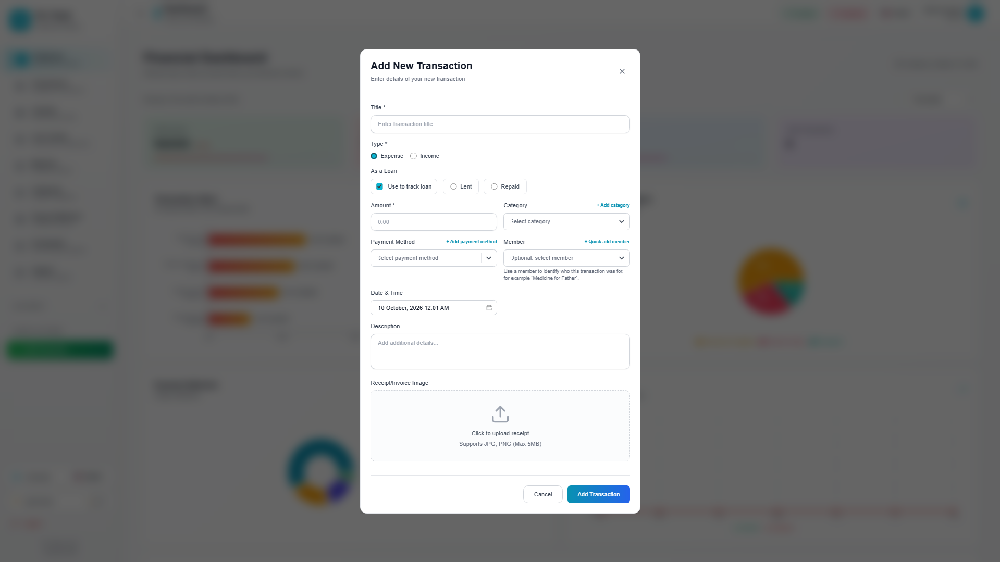 |
| *Modal form to create a new transaction — date picker (`flatpickr`), type selector, category dropdown, payment method, member, amount, and note.* | *Light theme variant of the add/edit transaction modal.* |

---

### 📅 3. Web Dashboard — Calendar View

| 🌙 Calendar View (Dark) | ☀️ Calendar View (Light) |
| :---: | :---: |
|  |  |
| *Month-grid calendar with per-day totals, visual heat indicators, and day drill-down to view that day's transactions.* | *Light theme calendar view with the same date-grid layout.* |

---

### 📂 4. Web Dashboard — Categories

| 🌙 Categories (Dark) | ☀️ Categories (Light) |
| :---: | :---: |
|  |  |
| *Category list with custom icons, colors, and usage counters (transaction count per category).* | *Light theme category list.* |

| 🌙 Add New Category (Dark) | ☀️ Add New Category (Light) |
| :---: | :---: |
|  |  |
| *Modal form to create a new category — name, icon, color picker, and description.* | * * | 

| 🌙 Edit Category (Dark) | ☀️ Edit Category (Light) |
| :---: | :---: |
| 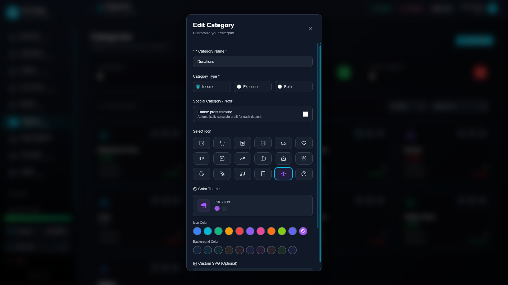 | 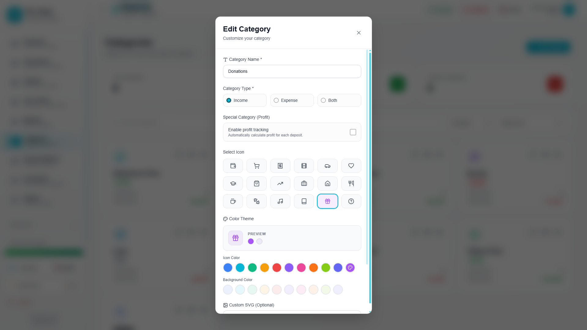 |
| *Edit existing category modal with the same fields pre-filled.* | * * |

| 🌙 View Category Detail (Dark) | ☀️ View Category Detail (Light) |
| :---: | :---: |
| 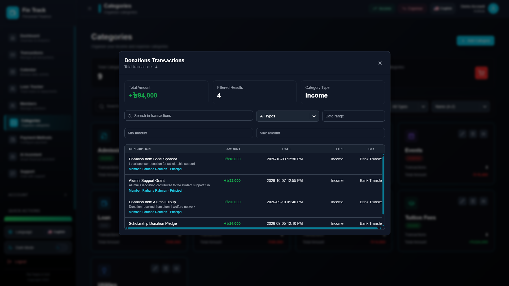 | 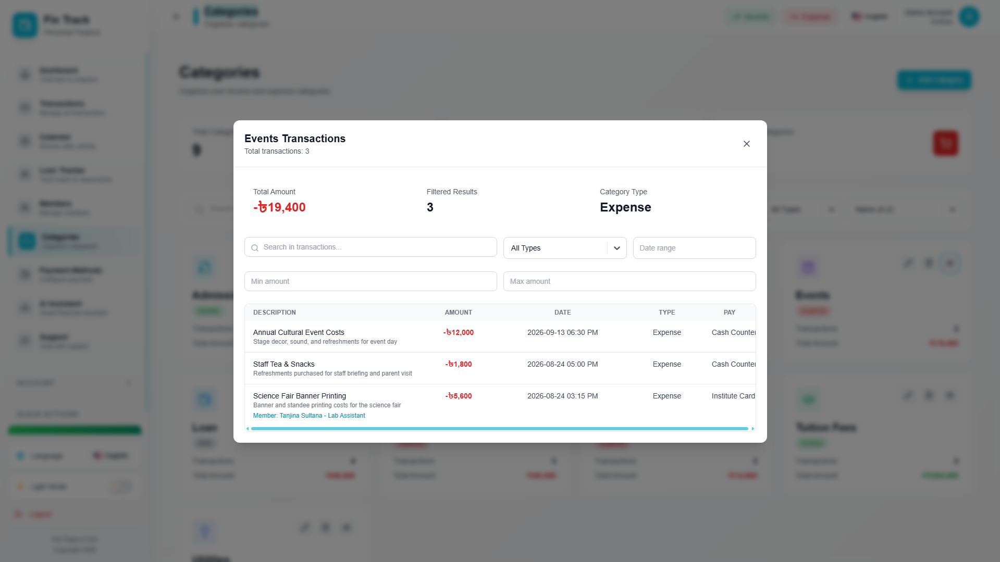 |
| *Drill-down view of a single category showing all transactions under it.* | * * |

---

### 💳 5. Web Dashboard — Payment Methods

| 🌙 Payment Methods (Dark) | ☀️ Payment Methods (Light) |
| :---: | :---: |
|  |  |
| *Payment method list with custom icons, colors, and transaction counters.* | *Light theme payment method list.* |

| 🌙 Add Payment Method (Dark) | ☀️ Add Payment Method (Light) |
| :---: | :---: |
| 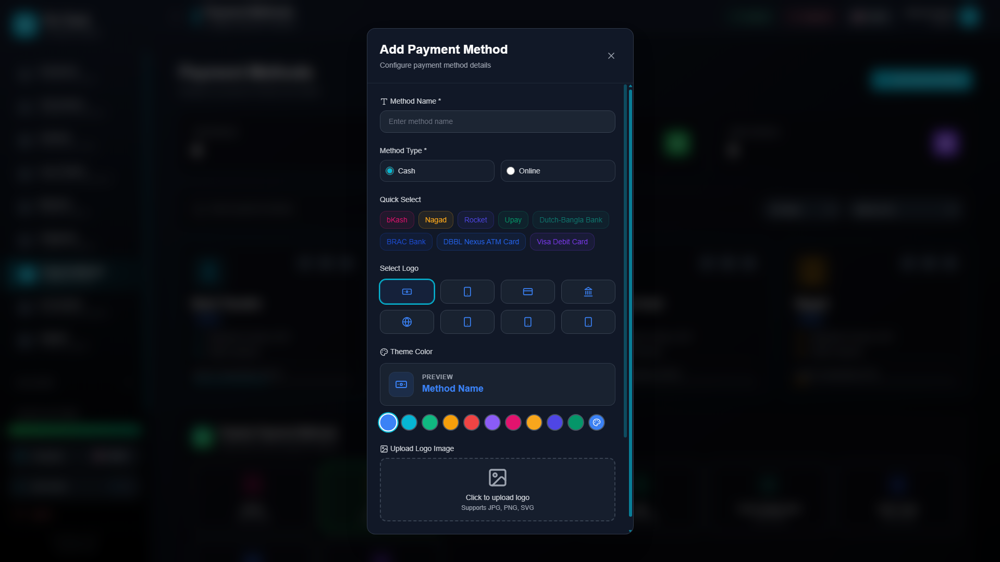 | 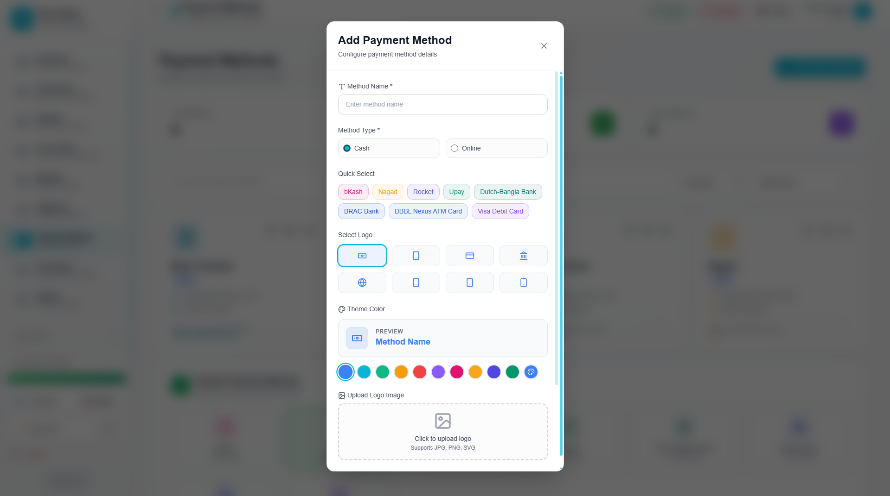 |
| *Modal form to add a new payment method (Cash / Bank / Card / Wallet / Custom).* | * * |

| 🌙 Edit Payment Method (Dark) | ☀️ Edit Payment Method (Light) |
| :---: | :---: |
| 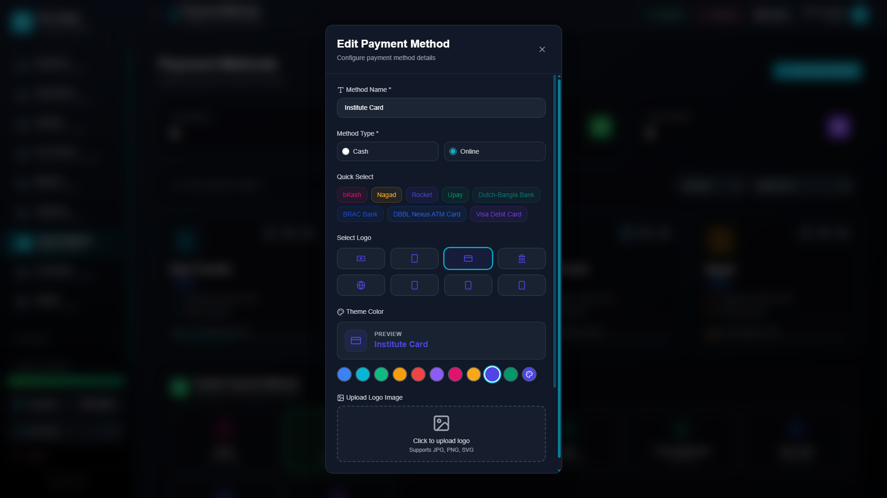 | 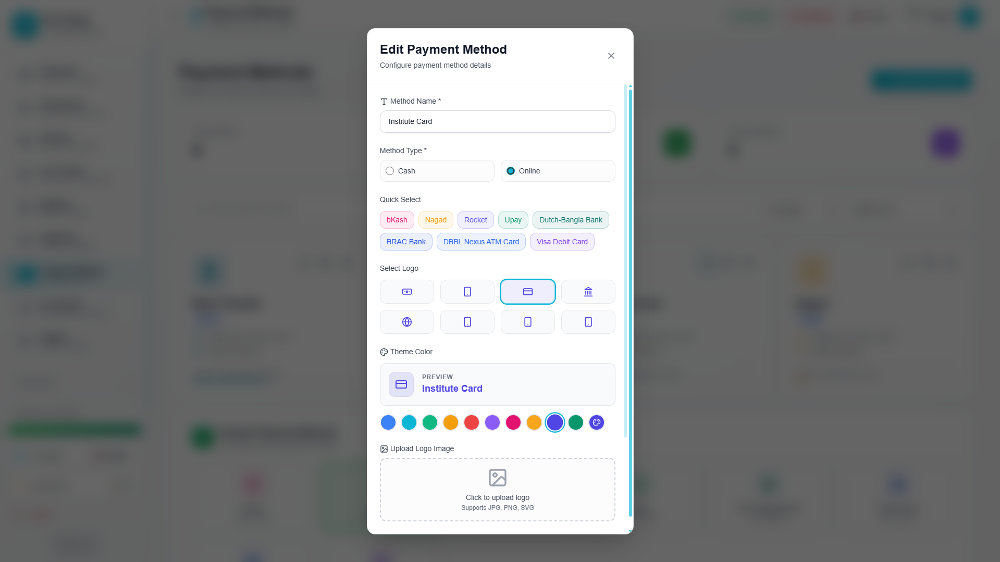 |
| *Edit existing payment method with the same form fields.* | * * |

| 🌙 View Payment Method Detail (Dark) | ☀️ View Payment Method Detail (Light) |
| :---: | :---: |
| 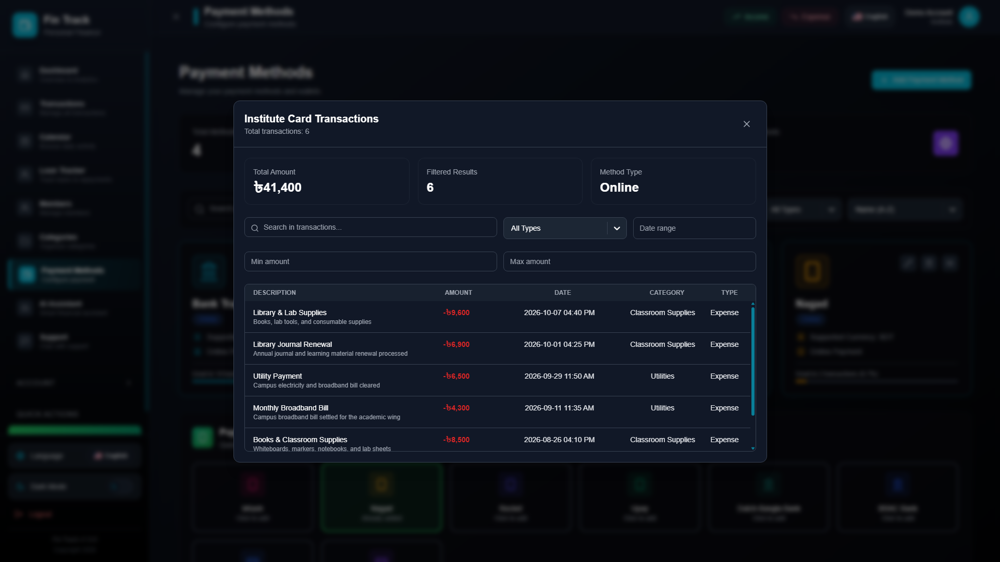 | 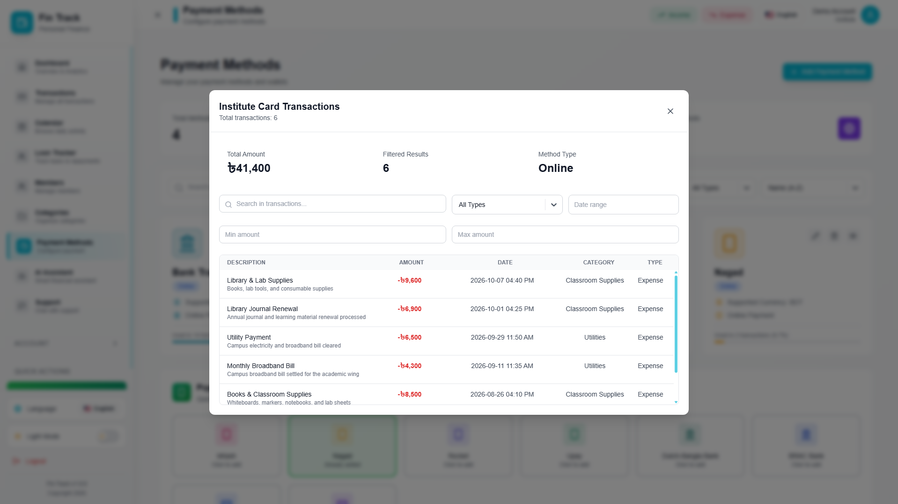 |
| *Drill-down view of a single payment method showing all transactions.* | * * |

---

### 👥 6. Web Dashboard — Members

| 🌙 Members (Dark) | ☀️ Members (Light) |
| :---: | :---: |
|  |  |
| *Member contact roster with avatars, relation, phone number, and per-member transaction count.* | *Light theme members list.* |

| 🌙 Member Detail (Dark) | ☀️ Member Detail (Light) |
| :---: | :---: |
|  |  |
| *Drill-down view of a single member showing all transactions and loans tied to them.* | * * |

---

### 🏦 7. Web Dashboard — Loan Tracker

| 🌙 Loan Tracker (Dark) | ☀️ Loan Tracker (Light) |
| :---: | :---: |
|  |  |
| *Loan list split into `You Owe` and `Owed to You` sections, each with repayment progress bars, settlement status, and per-loan history.* | *Light theme loan tracker.* |

---

### 🤖 8. Web Dashboard — AI Assistant (Google Gemini)

| 🌙 AI Assistant (Dark) | ☀️ AI Assistant (Light) |
| :---: | :---: |
|  |  |
| *In-app conversational assistant powered by Google Gemini with quick prompts (Spending Summary, Top Expenses, Saving Tips, How Features Work) and suggestion chips.* | *Light theme AI assistant with the same conversational UI.* |

---

### 👤 9. Web Dashboard — Profile & Multi-Entity Switcher

| 🌙 Profile & Entities (Dark) | ☀️ Profile & Entities (Light) |
| :---: | :---: |
| 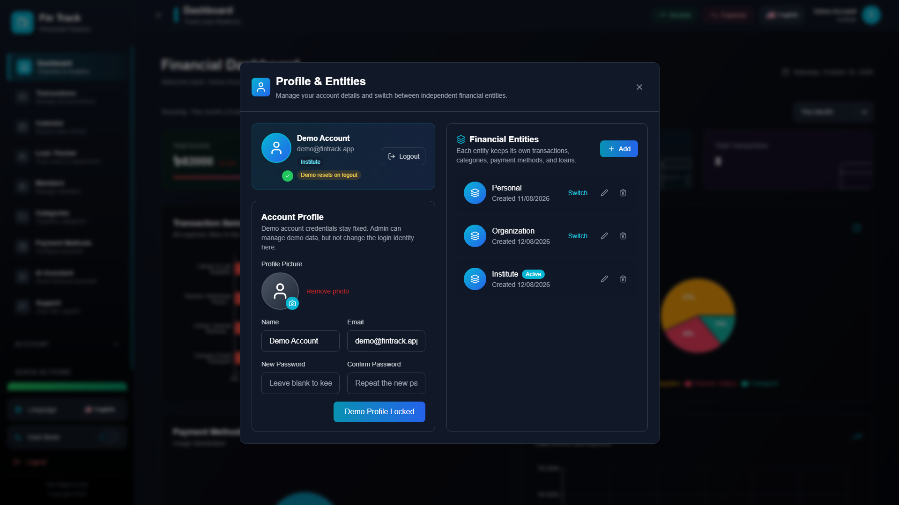 | 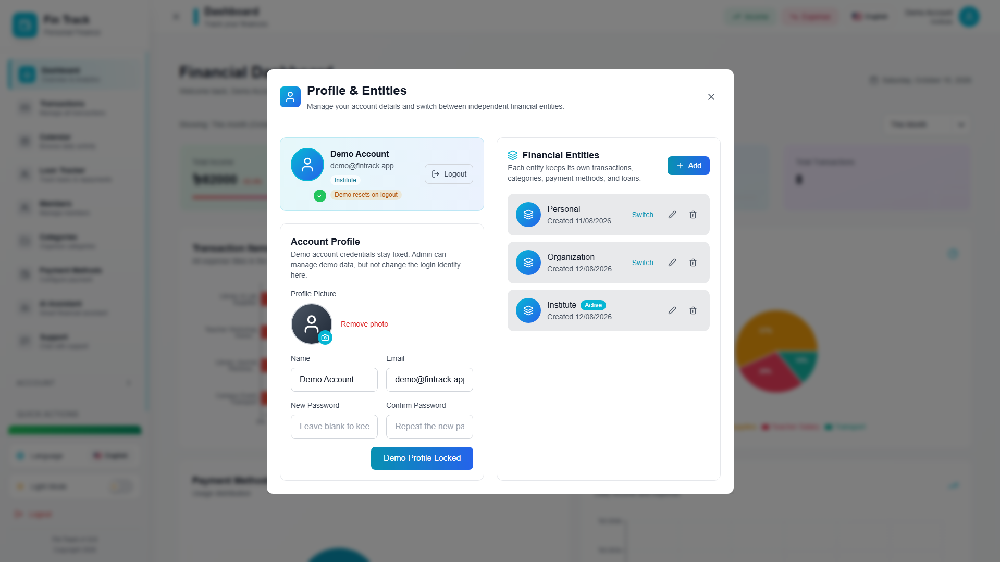 |
| *Profile editor plus the multi-entity switcher showing all `Personal`, `Organization`, and `Institute` ledgers the user has access to.* | *Light theme profile & entities view.* |

---

### 🌐 10. Web Dashboard — Language, Support & Misc

| 🌙 Select Language (Dark) | ☀️ Select Language (Light) |
| :---: | :---: |
| 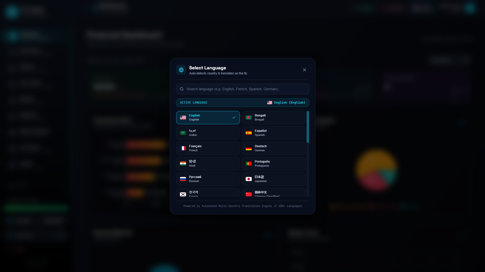 | 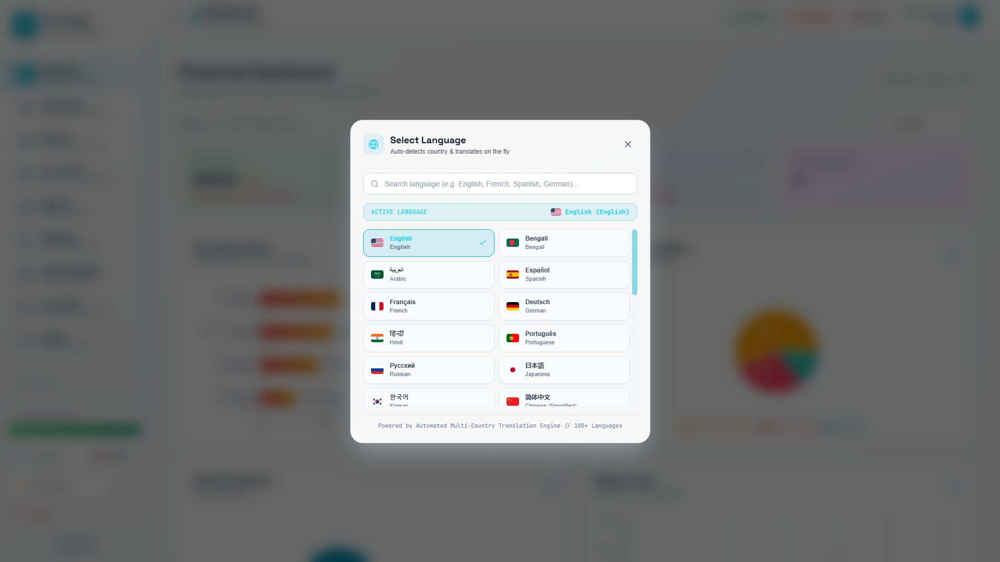 |
| *Language picker supporting Bengali (`bn`) and English (`en`) with native language labels.* | * * |

| 🌙 Support (Dark) | ☀️ Support (Light) |
| :---: | :---: |
|  |  |
| *Real-time support thread backed by Socket.IO — users open a thread and chat with the admin team live.* | *Light theme support view.* |

---

### 📱 11. Flutter Mobile App

The Flutter mobile companion is optimized for screens ≤640px wide, with a bottom navigation bar and bottom-sheet editors for touch-first data entry. Material 3 design with a cyan (`#06B6D4`) accent on a deep slate (`#020617`) dark theme.

| 📱 Home (Dark) | 📱 Home (Light) |
| :---: | :---: |
| 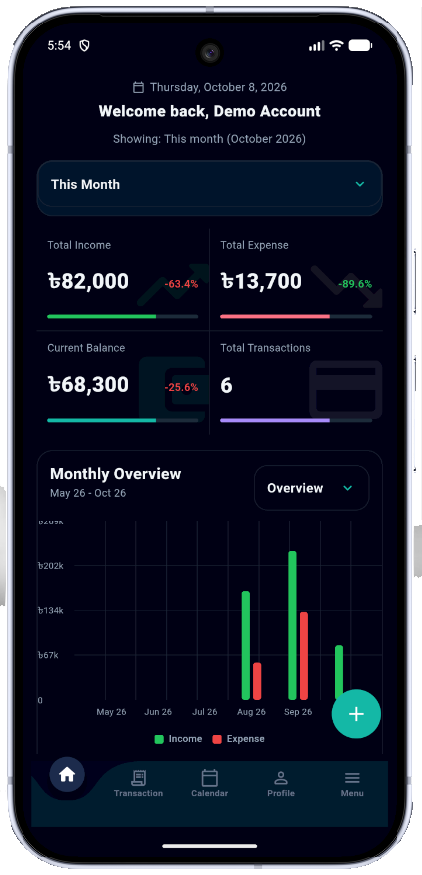 | 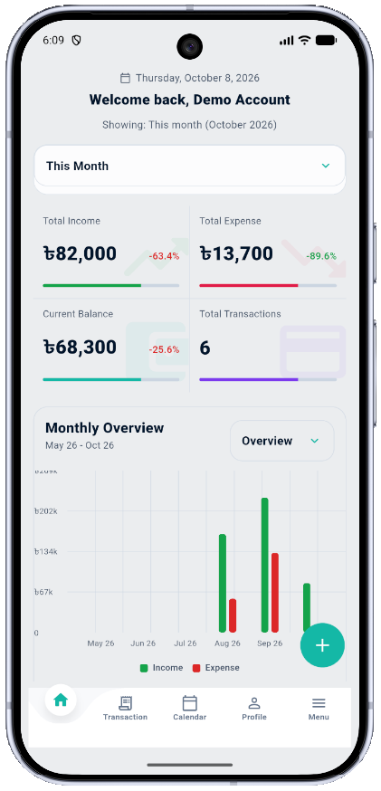 |
| *Mobile dashboard with stats summary, recent transaction feed, and condensed chart visualization.* | *Light theme mobile home.* |

| 📱 Transactions | 📱 Add Transaction |
| :---: | :---: |
| 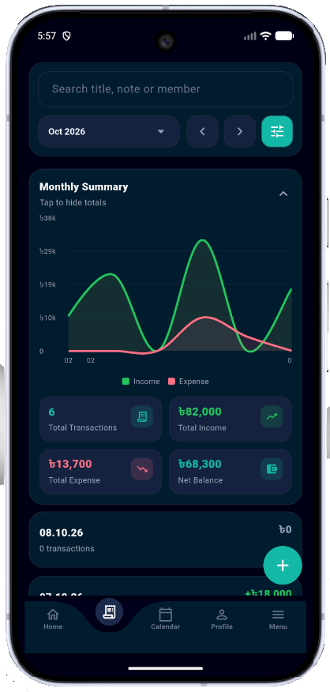 | 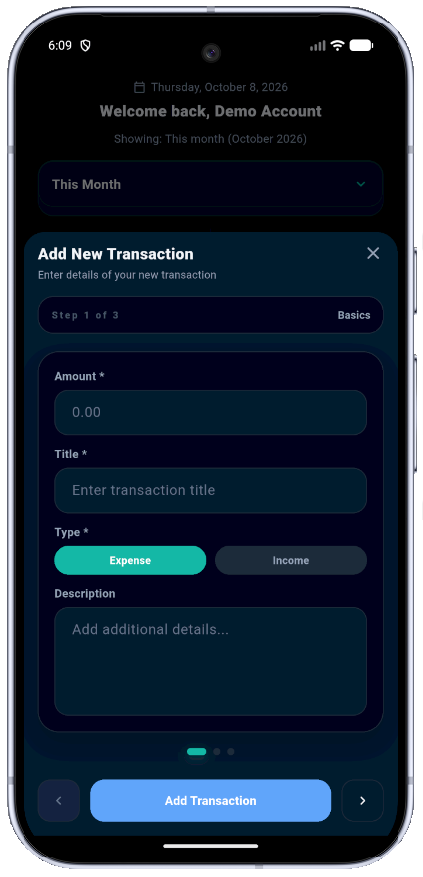 |
| *Mobile transaction list with swipe-to-edit and bottom-sheet filter.* | *Bottom-sheet transaction editor with date picker, type selector, category, payment method, and amount fields.* |

| 📱 Calendar | 📱 Loan Tracker |
| :---: | :---: |
| 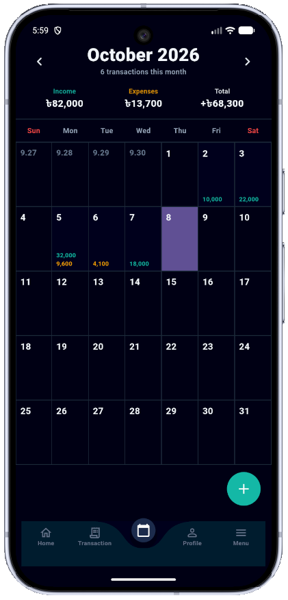 | 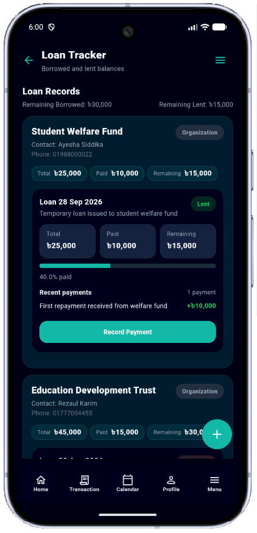 |
| *Mobile calendar view with day-tap drill-down to view transactions.* | *Mobile loan tracker with `You Owe` / `Owed to You` sections and progress chips.* |

| 📱 Categories | 📱 Category Details |
| :---: | :---: |
| 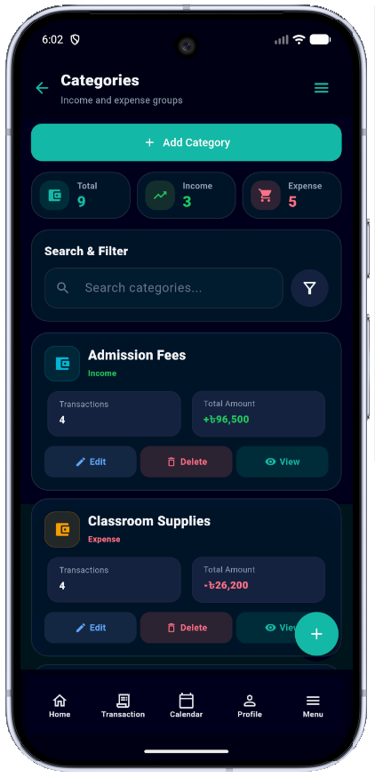 | 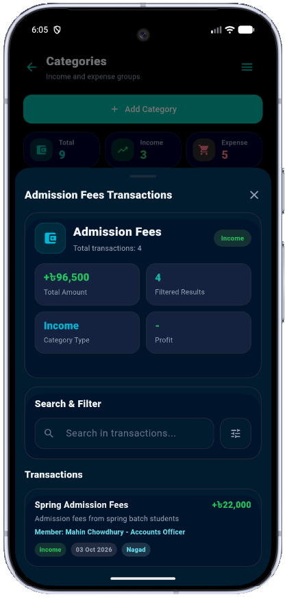 |
| *Mobile category list with custom icons and transaction counters.* | *Drill-down view of a single category with its associated transactions.* |

| 📱 Payment Methods | 📱 Payment Method Details |
| :---: | :---: |
| 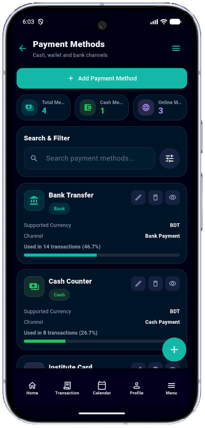 | 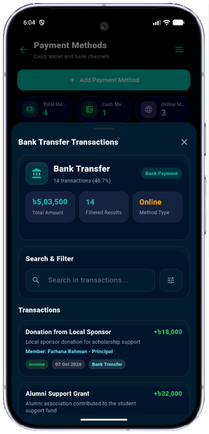 |
| *Mobile payment method list.* | *Drill-down view of a single payment method.* |

| 📱 Members | 📱 Member Details |
| :---: | :---: |
| 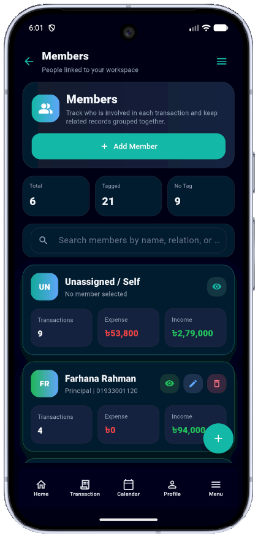 | 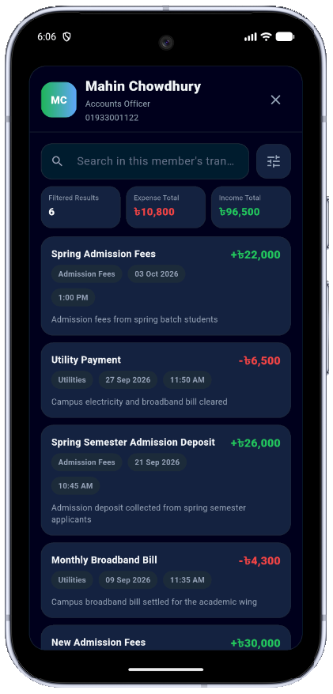 |
| *Mobile member roster with avatars and relation chips.* | *Drill-down view of a single member with their transactions and loans.* |

| 📱 Sidebar Menu | 📱 Light Variants |
| :---: | :---: |
| 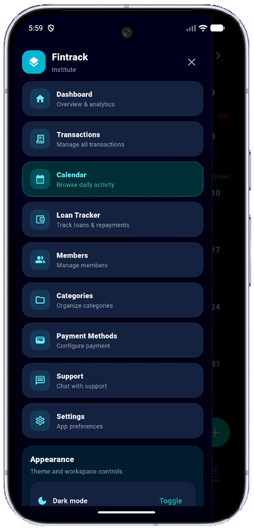 | .png) |
| *Mobile sidebar / overflow menu listing all secondary navigation items.* | *Additional light theme mobile screenshots covering home, transactions, calendar, categories, payment methods, members, and loan tracker.* |

---

## 🏗️ System Architecture

**Fin Track** is structured as a 3-tier application: a **React 18 Web SPA**, a **Flutter Mobile app**, and a **PHP/MySQL REST backend** with a **Node.js Socket.IO real-time server**. Both clients consume the same backend, ensuring data parity.

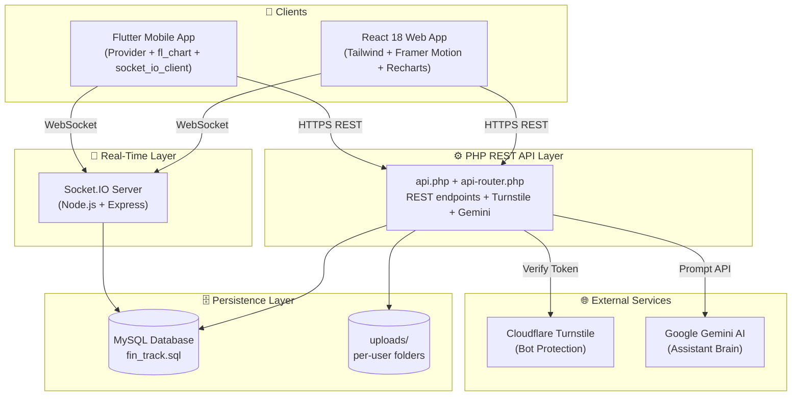

### Architectural Highlights
- **Shared Backend, Dual Client**: Both React Web and Flutter Mobile consume the same PHP REST API and Socket.IO server, ensuring zero data drift between surfaces.
- **Multi-Entity Isolation**: All transactional data is partitioned at the API by an `entity_type` column — switching entities at the client triggers a clean re-fetch with isolated state.
- **Server-Side AI**: The Gemini API key is stored server-side in Super Admin settings and never exposed to the browser or mobile client — clients send prompt text, the API calls Gemini and returns the response.
- **CMS-Driven Marketing**: All public landing-page content (`Hero`, `Features`, `How It Works`, `FAQ`, `Contact`, `Demo`) is editable through the `AdminLandingCms` panel without code changes.
- **Real-Time Support**: Support threads use Socket.IO rooms keyed to the user/admin pair — typing indicators and delivery receipts are emitted as scoped events.

---

## 🛡️ Security Engineering

| Security Domain | Implementation Details |
| :--- | --- |
| **Cloudflare Turnstile Bot Protection** | Active on signup & login flows; site key & secret key managed in Super Admin (keys never hard-coded). |
| **Rate Limiting** | Per-IP request rate limits (e.g. `3 /min`) and per-IP account-creation caps (e.g. `5 /day`) enforced at the PHP layer. |
| **Server-Side Gemini Key** | The Gemini API key is stored only in the Super Admin database and used server-side — never shipped to the browser or mobile client. |
| **Isolated Uploads** | User uploads live under `/uploads/users/<username>/...` with type-prefixed paths (`avatar`, `member`, `attachment`). |
| **Session & Auth Guards** | Login-protected pages verify session tokens at the PHP layer; idle session timeout hook on the web client auto-logs out inactive users. |
| **Admin Route Separation** | Admin and Super Admin use separate routes, credentials, and authorization checks — never mixed with regular user auth. |
| **Multi-Language Safety** | Bengali + English translations reviewed for safety; no user-generated content is rendered as raw HTML without sanitization. |

---

## 🧰 Tech Stack

- **Web Frontend**: React 18, React Router DOM 6, React Query (`@tanstack/react-query`), React Hook Form + `@hookform/resolvers`, `zod`, `class-variance-authority`, `tailwindcss` 3, `framer-motion`, `gsap`, `three.js`, `recharts`, `rsuite`, `simplebar-react`, `lucide-react`, `sonner`, `react-flatpickr`, `react-select`, `date-fns`, `lodash`, `crypto-js`, `html2canvas`, `jspdf`
- **Mobile (Flutter)**: Flutter 3.x, `http`, `provider`, `fl_chart`, `dropdown_button2`, `another_flushbar`, `image_picker`, `pdf`, `quickalert`, `flutter_swiper_view`, `socket_io_client`, `share_plus`, `file_picker`, `shared_preferences`, `intl`
- **Backend (REST)**: PHP 8, MySQL, Cloudflare Turnstile, Google Gemini API
- **Backend (Realtime)**: Node.js, Express, Socket.IO
- **Bot Protection**: Cloudflare Turnstile (managed keys)
- **AI**: Google Gemini (server-side key)
- **Deployment**: cPanel automated deployment workflow (commit + htaccess configured), GitHub Actions CI
- **Tooling**: ESLint, PostCSS, Autoprefixer, Create React App 5, `@vitejs/plugin-react` (dev), PowerShell (`mobile-run.ps1`)

---

## 🛠️ Local Development

> [!NOTE]
> **Source code is private.** This section describes the developer experience for authorized collaborators.

### Web
```bash
cd web-app
npm install
npm start          # concurrently runs React (3000) + PHP API (8000) + Socket.IO
npm run build      # production build into web-app/build
```

### Mobile (Flutter)
```bash
cd flutter-app
flutter pub get
npm start                                                # uses mobile-run.ps1
# or
php -S 127.0.0.1:8001 api-router.php                       # terminal 1
flutter run --dart-define=API_BASE_URL=http://10.0.2.2:8001 # terminal 2 (Android emulator)
```

### Backend Only
```bash
php -S 127.0.0.1:8001 api-router.php                       # REST API
node server/server.js                                    # Socket.IO server
```

---

## 📥 Installation & Releases

> [!NOTE]
> **Development is currently in progress.** Final Web build (static `build/` folder), Android APK, and iOS build artifacts will be shared in the [**Releases**](../../releases) section once completed.

Once released, the deployment pipeline will provide:
1. A static `build/` folder deployable to any static host or cPanel.
2. An Android `.apk` / `.aab` built via `flutter build apk --release`.
3. Configuration notes for Cloudflare Turnstile keys and Gemini API key.

---

## 📜 License & Source Availability

The **Fin Track** source code (web app, mobile app, backend, and database schema) is maintained in a **private repository** and is **not publicly distributed**. This `fintersack-showcase` repository exists solely as a visual & architectural reference.

For collaboration, sponsorship, or licensing inquiries, please reach out via the GitHub profile.

---

<div align="center">

**Designed & Engineered with ❤️ for Smart Money Management**

</div>